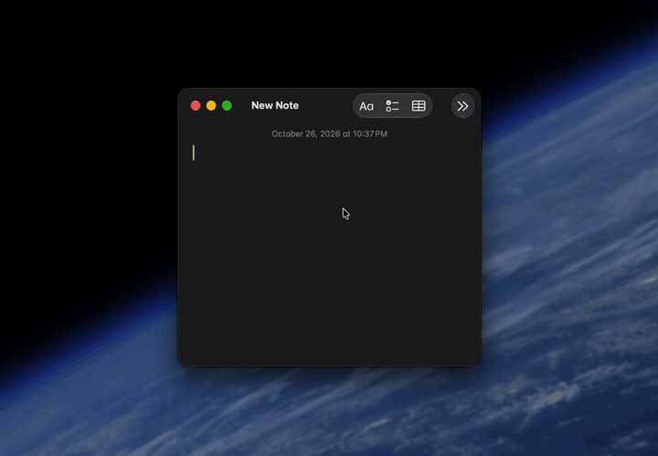
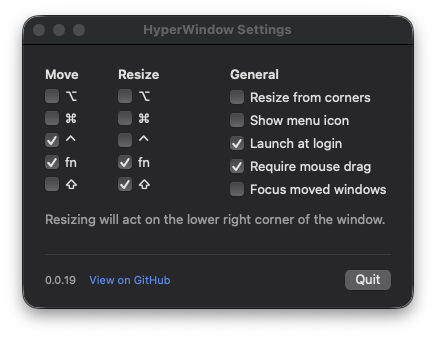

<p align="center">
  
</p>

<h1 align="center">HyperWindow</h1>

Resize & move apps from anywhere on the window with custom modifiers.



When the modifiers are active, the cursor position can resize or move the window from anywhere over the app. The cursor follows the window.



You may resize from the nearest corner instead of a left-to-right resize. It's also possible to enable activation by the mouse drag action instead of merely hovering over the window, or focus a window whenever HyperWindow moves or resizes it.

If you only need window movement, macOS has a built-in fixed `ctrl+cmd` drag alternative.

```sh
defaults write -g NSWindowShouldDragOnGesture -bool true
```

## Releases

Releases are [built, Developer ID signed, and notarized by a GitHub Action](https://github.com/brettinternet/HyperWindow/actions). Download the DMG from [GitHub releases](https://github.com/brettinternet/HyperWindow/releases) and drag HyperWindow to Applications.

### Build

HyperWindow requires macOS 15.2 or newer. Xcode is required to build the app. Run the release task from `Taskfile.dist.yaml`.

```sh
task build:release # build, ad-hoc sign, and verify the universal app
task copy:release  # build and copy the app to /Applications
task package:release RELEASE_TAG=v0.0.10 # create the DMG and checksum
```

Open the app `build/Build/Products/Release/HyperWindow.app`.

### Publish

Update `MARKETING_VERSION` in the Xcode project, commit it, then push the matching tag:

```sh
git tag v0.0.10
git push origin v0.0.10
```

Tags matching `vMAJOR.MINOR.PATCH` (optionally `-alpha.N`, `-beta.N`, or `-rc.N`) run tests, build the universal app, sign and notarize a DMG, and publish it with a checksum as a GitHub release. Signing credentials live in the `release` environment, which only `v*` tags can use. Prerelease tags create prerelease GitHub releases.

To rotate signing credentials, export a new Developer ID Application certificate as a `.p12` or create a new App Store Connect team key, then replace the matching secret with `gh secret set <NAME> --env release`: `DEVELOPER_ID_P12_BASE64` and `DEVELOPER_ID_P12_PASSWORD`, or `NOTARY_KEY_P8_BASE64`, `NOTARY_KEY_ID`, and `NOTARY_ISSUER_ID`. If a certificate leaks, revoke it in the Apple Developer portal after the replacement is in place.

## Known Limitations

This app uses the macOS Accessibility APIs in order to discover windows and update their position and size. Some apps such as Telegram and Stream Deck create windows that don't participate in this mechanism and are invisible to this software.
